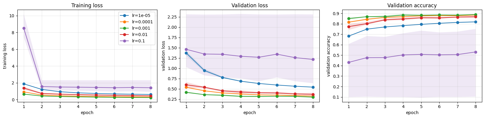
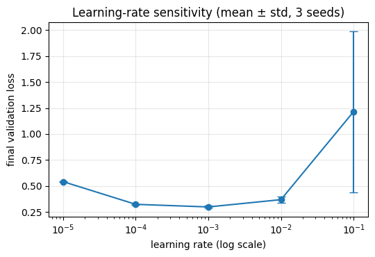

##  How Learning Rate Shapes the Journey of a Small CNN

  
  
🐾 Exploring deep learning, one experiment at a time!

  ✦ CNNs • Fashion-MNIST • Learning Rates ✦

## 🐾 Introduction

Have you ever wondered why a neural network sometimes learns well but sometimes struggles to improve? One important reason is the learning rate. Even when using the same dataset and model, changing the learning rate can affect how fast and how well a model learns. In this experiment, I wanted to find out how different learning rates affect the performance of a small Convolutional Neural Network (CNN) using the Fashion-MNIST dataset.

## 🧠 What Is a Learning Rate?

A learning rate is an important hyperparameter in deep learning. It controls how much a model changes its weights while learning. A neural network learns by making predictions, checking its errors, and adjusting its weights to reduce those errors. These errors are measured using something called loss.

The learning rate controls the size of each adjustment. If the learning rate is too small, the model learns very slowly because it makes tiny updates. If it is too large, the model may make updates that are too big and fail to reach a good solution.

A simple way to understand this is to imagine walking down a hill. If your steps are too small, reaching the bottom takes a long time. If your steps are too large, you might skip over the lowest point. The goal is to find a step size that allows you to move toward the bottom smoothly.

The learning rate is called a hyperparameter because it is selected before training rather than learned directly by the model. In this experiment, I used different learning rates to observe how they affected the training and validation results.

## 🧪 The Experiment

I tested the same small CNN using five different learning rates. Each learning rate was tested three times using seeds 0, 1, and 2. I kept the other experiment settings the same so I could compare the results fairly.

| Item | Value |
|---|---|
| Dataset | Fashion-MNIST |
| Training subset | 10,000 images |
| Validation set | 6,000 images |
| Test set | Kept separate until final evaluation |
| Model | Small CNN with 32 and 64 convolutional channels and 128 hidden units |
| Optimizer | Adam |
| Batch size | 64 |
| Epochs | 8 |
| Learning rates | 0.00001, 0.0001, 0.001, 0.01, 0.1 |
| Seeds | 0, 1, 2 |

The experiment focused on changing only the learning rate while keeping the other settings the same. This helped me observe how the learning rate affected model performance.

## 📊 Results

The results showed that the learning rate had a noticeable effect on the model. Among the five settings, 0.001 achieved the highest average validation accuracy and the lowest average validation loss.

*Figure 1. Training loss, validation loss, and validation accuracy across eight epochs for the five learning rates. The curves show how the model's learning behavior changed depending on the learning rate.*

| Learning Rate | Best Validation Accuracy | Final Validation Loss |
|---|---:|---:|
| 0.00001 | 81.93% ± 0.32 | 0.541 ± 0.002 |
| 0.0001 | 88.47% ± 0.14 | 0.323 ± 0.003 |
| **0.001** | **89.13% ± 0.26** | **0.298 ± 0.010** |
| 0.01 | 87.07% ± 0.72 | 0.368 ± 0.030 |
| 0.1 | 53.12% ± 30.28 | 1.215 ± 0.774 |

*Table 1. Average best validation accuracy and final validation loss across three runs for each learning rate.*

The learning rate of 0.001 performed best overall. Meanwhile, the learning rate of 0.1 produced inconsistent results. One of its three runs reached only 10.30% validation accuracy, which is close to random guessing for a dataset with ten classes.

| Seed | Best Validation Accuracy at Learning Rate 0.1 | Final Validation Loss |
|---|---:|---:|
| 0 | 75.17% | 0.636 |
| 1 | 10.30% | 2.309 |
| 2 | 73.90% | 0.698 |

*Table 2. Results for each seed using a learning rate of 0.1.*

*Figure 2. Final validation loss for each learning rate. The lowest average validation loss occurred at 0.001.*

The best setting, using a learning rate of 0.001 and seed 0, was also evaluated on the test set. It achieved 88.17% test accuracy with a test loss of 0.326.

## 💜 Discussion

The experiment showed that choosing the right learning rate is important for training a neural network.

When the learning rate was too small, such as 0.00001, the model learned more slowly. It reached only 81.93% average best validation accuracy after eight epochs. This suggests that the model may have needed more training time to improve further.

When the learning rate was too large, such as 0.1, the results became unstable. Two runs achieved around 74% to 75% validation accuracy, but one run dropped to 10.30%. This shows that very large updates can make training difficult and inconsistent.

The learning rate of 0.001 achieved the best average validation accuracy of 89.13% and the lowest average validation loss of 0.298. This result supports the common practice of starting with a learning rate around 0.001 when using Adam.

However, the difference between 0.001 and 0.0001 was relatively small. Since I only used three seeds for each setting, more experiments would be needed to confirm whether this difference is consistent.

### 🐱 Limitations

There were some limitations in this experiment. First, I only used 10,000 training images instead of the full Fashion-MNIST training dataset. Second, the model was trained for only eight epochs. Third, I tested only one CNN architecture and one optimizer. Finally, using only three seeds may not fully represent how much the results can vary.

## ✨ Takeaways

Based on this experiment, I learned that the learning rate can greatly affect how a neural network trains. A learning rate that is too small can slow down learning, while one that is too large can make training unstable.

For this experiment, 0.001 was the best-performing learning rate for the CNN using Adam. I also learned that testing different settings and using multiple seeds are important when evaluating a model.

## 💜 Code and Reproducibility

The experiment notebook and figures are available in my GitHub repository:

[Finding the Right Learning Rate](https://github.com/nic340/finding-the-right-learning-rate)

## 📚 References

- Instructor-provided `Hyperparameters.ipynb` notebook, used as a guide and starting point.
- Kingma, D. P., & Ba, J. (2015). *Adam: A Method for Stochastic Optimization.* arXiv:1412.6980.
- Xiao, H., Rasul, K., & Vollgraf, R. (2017). *Fashion-MNIST: A Novel Image Dataset for Benchmarking Machine Learning Algorithms.* arXiv:1708.07747.
- PyTorch Lightning Documentation: https://lightning.ai/docs/pytorch/stable/

## AI Use Disclaimer

The `Hyperparameters.ipynb` notebook was provided by my instructor as a guide and starting point. The `learning_rate_experiment.ipynb` notebook contains my experiment, which I worked on with assistance from Claude. I used ChatGPT to help organize and review my blog draft and check the consistency of the experiment details and results.
